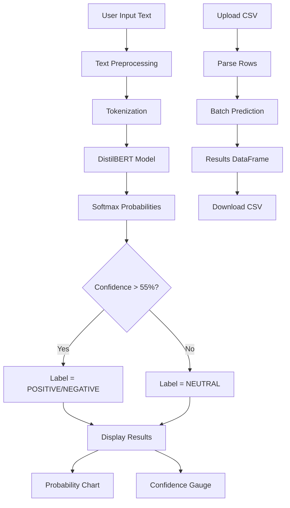

# 💬 Sentiment Analysis Classifier

> An interactive NLP application that uses a pretrained DistilBERT transformer to classify text sentiment as **Positive**, **Negative**, or **Neutral**.


---

## 📖 Project Overview

This application provides an interactive web interface for sentiment analysis using state-of-the-art transformer models. Users can input individual texts or upload CSV files for batch processing, with results visualized through professional charts and gauges.

## 🎯 Problem Statement

Understanding sentiment in text is a fundamental NLP task with applications in:
- Customer feedback analysis
- Social media monitoring
- Product review summarization
- Brand reputation tracking

This project demonstrates how pretrained transformer models can be leveraged for production-ready sentiment classification without requiring expensive training from scratch.

## 🏆 Objectives

1. Build an interactive sentiment analysis web application.
2. Use a pretrained transformer model (DistilBERT) for inference.
3. Support both single-text and batch CSV processing.
4. Provide professional visualizations of prediction results.
5. Deploy to Hugging Face Spaces for public access.

## ✨ Key Features

| Feature | Description |
|---------|-------------|
| **Single Text Analysis** | Enter text and get instant sentiment prediction with confidence scores |
| **Batch CSV Processing** | Upload CSV files for bulk analysis with downloadable results |
| **Probability Visualization** | Interactive charts showing class probability distribution |
| **Confidence Gauge** | Semi-circular gauge showing prediction confidence |
| **Example Texts** | Pre-loaded examples for quick testing |
| **Neutral Detection** | Low-confidence predictions classified as Neutral |
| **Professional UI** | Clean SaaS-style dashboard with responsive layout |

## 🛠️ Technologies Used

- **Python 3.10+** — Primary programming language
- **Streamlit** — Web UI framework
- **Hugging Face Transformers** — Model library and inference
- **PyTorch** — Deep learning backend
- **DistilBERT** — Transformer model (SST-2 fine-tuned)
- **Plotly** — Interactive data visualizations
- **Pandas** — Data handling for batch processing
- **pytest** — Testing framework

## 🧠 Model Architecture and Methodology

### Model: `distilbert-base-uncased-finetuned-sst-2-english`

| Property | Value |
|----------|-------|
| Architecture | DistilBERT |
| Parameters | ~67 million |
| Transformer Layers | 6 |
| Hidden Size | 768 |
| Attention Heads | 12 |
| Vocabulary Size | 30,522 |
| Training Data | SST-2 (Stanford Sentiment Treebank) |
| Native Labels | POSITIVE, NEGATIVE |

### Neutral Sentiment Derivation

The base model is trained for binary classification (Positive/Negative). To provide a **Neutral** class:

1. The model outputs softmax probabilities for POSITIVE and NEGATIVE.
2. If the maximum probability is **below 55%**, the text is classified as **NEUTRAL**.
3. This approach avoids loading a heavier 3-class model while providing practical neutral detection.

### Inference Pipeline

```
Raw Text → Unicode Normalization → Control Char Removal → Whitespace Cleanup
→ Tokenization (max 512 tokens) → DistilBERT Inference → Softmax
→ Confidence Threshold Check → Final Label
```

## 📊 Dataset Information

The model is pre-trained and fine-tuned on the **SST-2 (Stanford Sentiment Treebank)** dataset by Hugging Face. No additional dataset is required for this application — the model is downloaded automatically from the Hugging Face Hub.

- **SST-2 Source:** [Stanford Sentiment Treebank](https://nlp.stanford.edu/sentiment/)
- **License:** The model is available under the Apache 2.0 license.

## 🔄 Workflow Diagram



## 📁 Project Structure

```
sentiment-analysis-nlp/
├── app.py                      # Main Streamlit application
├── requirements.txt            # Python dependencies
├── README.md                   # This file
├── .gitignore                  # Git ignore rules
├── src/
│   ├── __init__.py
│   ├── sentiment_model.py      # Model loading and inference
│   └── preprocessing.py        # Text cleaning and validation
├── models/
│   └── .gitkeep               # Model cache (downloaded at runtime)
├── utils/
│   ├── __init__.py
│   ├── visualization.py       # Plotly charts and gauges
│   └── csv_handler.py         # Batch CSV processing
├── tests/
│   ├── __init__.py
│   └── test_sentiment.py       # Test suite
└── .streamlit/
    └── config.toml             # Streamlit configuration
```

## 🚀 Installation Instructions

### Prerequisites

- Python 3.10 or higher
- pip (Python package installer)
- Internet connection (for model download on first run)

### Setup

```bash
# Clone the repository
git clone https://github.com/Sawaira-saeed/sentiment-analysis-nlp.git
cd sentiment-analysis-nlp

# Create and activate a virtual environment
python -m venv .venv

# On Windows
.venv\Scripts\activate

# On macOS/Linux
source .venv/bin/activate

# Install dependencies
pip install -r requirements.txt
```

## 🖥️ Local Execution Instructions

```bash
# Ensure the virtual environment is activated
streamlit run app.py
```

The application will open in your browser at `http://localhost:8501`.

**First run note:** The model (~268 MB) will be downloaded automatically from Hugging Face on the first run. Subsequent runs use the cached version.

## 🤗 Hugging Face Deployment Instructions

### Step-by-Step Guide

1. **Create a Hugging Face account** at [huggingface.co](https://huggingface.co) if you don't have one.

2. **Create a new Space:**
   - Go to [huggingface.co/new-space](https://huggingface.co/new-space)
   - Name: `sentiment-analysis-nlp`
   - SDK: **Streamlit**
   - License: MIT
   - Hardware: CPU (free tier)
   - Space visibility: Public

3. **Clone the Space locally:**
   ```bash
   git clone https://huggingface.co/spaces/Sawaira-saeed/sentiment-analysis-nlp
   ```

4. **Copy project files** into the Space directory (all files except `.venv/` and `tests/`).

5. **Commit and push:**
   ```bash
   git add .
   git commit -m "Initial deployment"
   git push
   ```

6. **Access your app** at `https://Sawaira-saeed-sentiment-analysis-nlp.hf.space`

### Notes
- The free CPU tier is sufficient for DistilBERT inference.
- Model download happens automatically on first deployment.
- No API keys or secrets are required.

## 📝 Sample Input and Output

### Sample Input
```
This product is absolutely amazing! The quality exceeds my expectations
and the customer service was outstanding.
```

### Sample Output
```
Sentiment: 😊 POSITIVE
Confidence: 99.87%

Class Probabilities:
  POSITIVE: 99.87%
  NEGATIVE:  0.13%
```

## 📸 Screenshots

Screenshots can be captured by running the application locally:

1. Run `streamlit run app.py`
2. Navigate to each page (Single Analysis, Batch Analysis, Model Info, About)
3. Take screenshots using your OS tools
4. Save to a `screenshots/` directory

**Recommended screenshots:**
- `single_analysis.png` — Main prediction view
- `batch_analysis.png` — CSV upload and results
- `model_info.png` — Model information page

## ⚠️ Limitations

1. **Binary base model:** The underlying DistilBERT model is trained for binary classification. Neutral is derived via confidence threshold, not natively predicted.
2. **English only:** The model is trained on English text. Non-English input will produce unreliable results.
3. **Max 512 tokens:** Very long texts are truncated to 512 tokens.
4. **No sarcasm detection:** Transformer models struggle with sarcastic text.
5. **Context limit:** The model analyzes text in isolation without conversational context.

## 🔮 Future Improvements

1. **Multi-language support:** Integrate a multilingual sentiment model (e.g., XLM-RoBERTa).
2. **Native 3-class model:** Switch to a model trained with explicit Neutral labels.
3. **Aspect-based sentiment:** Analyze sentiment for specific aspects (e.g., price, quality, service).
4. **Real-time streaming:** Process streaming text data (e.g., live tweets).
5. **Model comparison:** Allow users to compare predictions from multiple models.
6. **Fine-tuning interface:** Enable users to fine-tune on custom datasets.

## 👤 Author

**AI-NLP-Portfolio**

Built as part of a professional AI/ML portfolio showcasing NLP and transformer model expertise.

---

*This application uses the [distilbert-base-uncased-finetuned-sst-2-english](https://huggingface.co/distilbert-base-uncased-finetuned-sst-2-english) model from Hugging Face.*